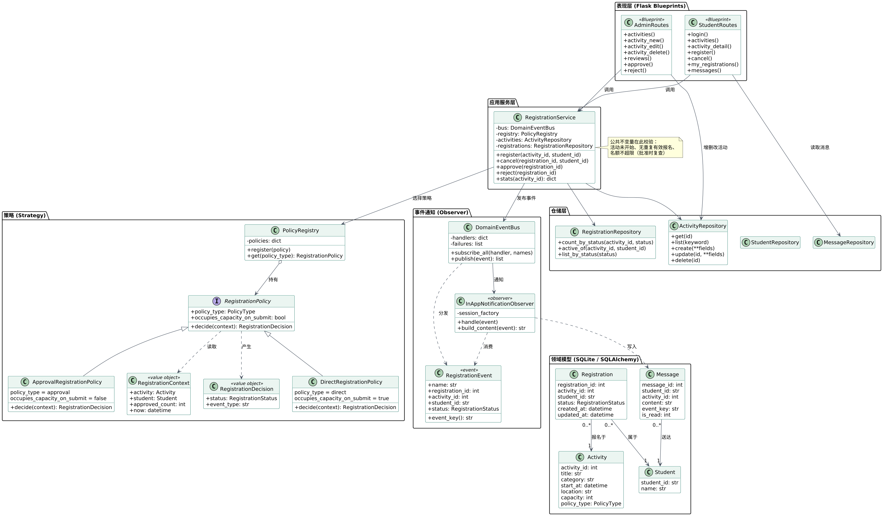

# 03 类图与职责划分（baseline-v1，v2 增补见 3.5）



源文件：`docs/uml/class-diagram.puml`（PlantUML，可重新渲染）

## 3.1 分层与依赖方向

```
表现层 StudentRoutes / AdminRoutes
      │  只做参数解析、登录校验、页面渲染
      ▼
应用服务层 RegistrationService
      │  业务规则唯一入口
      ├──> 仓储层 ActivityRepository / RegistrationRepository / StudentRepository / MessageRepository
      ├──> 策略层 PolicyRegistry → RegistrationPolicy（两个实现）
      └──> 事件层 DomainEventBus → InAppNotificationObserver
                  │
                  ▼
            领域模型 Activity / Student / Registration / Message（SQLite）
```

依赖方向单向向下：表现层不直接写数据库，领域模型不依赖任何上层，事件层不反向调用服务层。

## 3.2 各类职责

| 类 / 模块 | 职责 | 不负责 |
|---|---|---|
| `StudentRoutes` / `AdminRoutes` | 解析表单、登录态与权限判断、调用服务、渲染页面、把业务异常转成中文提示 | 任何业务规则判断、SQL |
| `RegistrationService` | 报名、取消、批准、拒绝、统计；校验公共不变量（活动未开始、无重复、不超容量）；决定事件发布时机 | 具体“提交后是什么状态”（交给策略）、通知怎么写（交给观察者） |
| `RegistrationPolicy`（抽象） | 声明稳定契约：`decide(context)` 返回初始状态与事件；声明 `occupies_capacity_on_submit` | 容量数值校验、数据库写入 |
| `DirectRegistrationPolicy` | 返回“已通过 + registration.approved”，声明提交即占名额 | — |
| `ApprovalRegistrationPolicy` | 返回“待审核 + registration.submitted”，声明提交不占名额 | — |
| `PolicyRegistry` | 按 `policy_type` 取实现，避免服务层出现类型分支 | 规则本身 |
| `RegistrationContext` / `RegistrationDecision` | 策略的输入 / 输出值对象，只读、不可变，便于测试 | — |
| `DomainEventBus` | 订阅与分发领域事件；捕获处理器异常并留痕，保证主流程不中断 | 通知内容、通知渠道 |
| `RegistrationEvent` | 事件数据载体；`event_key` 提供幂等键 | — |
| `InAppNotificationObserver` | 把事件翻译为站内消息文案，独立事务写入，按 `event_key` 去重 | 决定谁该通知、报名是否成立 |
| 四个 Repository | 封装查询与写入 SQL；提供按状态计数、查有效报名等语义方法 | 业务判断 |
| 领域模型 | 字段与关系（Registration → Activity、Registration → Student、Message → Student） | 业务流程 |

## 3.3 关键关系说明

- **组合/持有**：`PolicyRegistry` 持有若干 `RegistrationPolicy` 实例；新增规则只需注册实现，服务层不变。
- **依赖**：`RegistrationService` 依赖策略抽象、事件总线抽象与仓储，而不是具体实现，便于替换与单测。
- **一对多**：`Activity` 1—N `Registration`；`Student` 1—N `Registration`；`Student` 1—N `Message`。
- **观察者**：`DomainEventBus` 只认识“处理器”这一角色，`InAppNotificationObserver` 是其中一个订阅者。

## 3.4 状态机（Registration）

```
            ┌─────────────── 直接报名 ───────────────┐
            ▼                                        │
   (提交) 已通过 ──取消──> 已取消 ──再次申请──> 待审核 / 已通过
            ▲
            │ 批准
        待审核 ──拒绝──> 已拒绝 ──再次申请──> 待审核 / 已通过
```

规则：`待审核`→`已通过`（批准，需复查名额）或 `已拒绝`；`待审核/已通过`→`已取消`（学生本人、活动未开始）；
`已拒绝/已取消` 为终态，但允许学生重新提交，产生新的记录。

## 3.5 v2 新增类与职责（详见 docs/uml/class-diagram-v2.png）

| 类 / 构件 | 职责 | 归属模式 |
|---|---|---|
| GradeRangeRule | 读 Activity.min_grade/max_grade，判断学生 grade 是否在闭区间内；越界抛 GradeNotAllowed | 规则（Rule） |
| CompositePolicy | 先执行规则链，再把 RegistrationContext 交给内层策略，产出 RegistrationDecision | 组合 |
| GradeLimitedDirectPolicy | CompositePolicy([GradeRangeRule], DirectRegistrationPolicy)，占用名额语义与直接报名一致 | 策略 |
| EmailSender / MockEmailSender | 邮件发送端口与模拟实现，ail_times 可注入故障 | 端口—适配器 |
| EmailNotificationObserver | 订阅 approved / rejected，查重后发送并落 EmailRecord；失败先记录再抛出 | 观察者 |
| EmailRecord | 邮件审计表：收件人、主题、正文、状态、错误、vent_key、时间 | 持久化 |

依赖方向不变：新增类只依赖 constants / errors / models / events，RegistrationService 不反向依赖通知与邮件。
