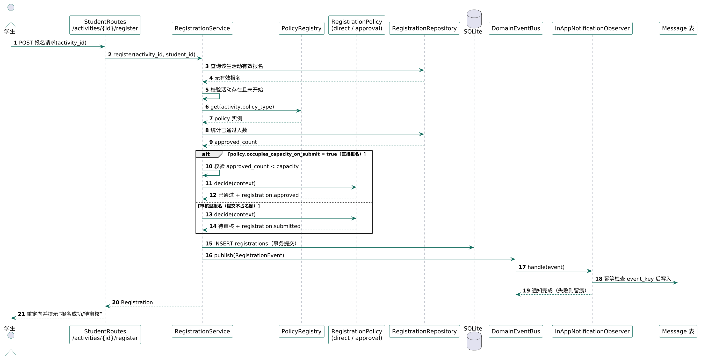
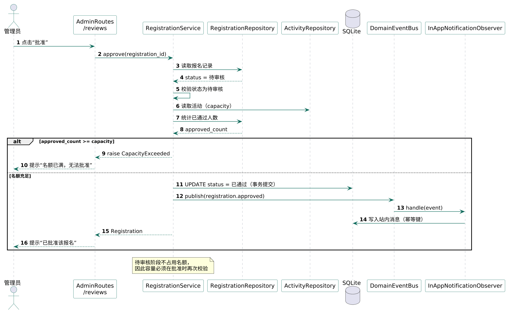

# 04 关键交互时序图

## 4.1 报名流程（直接报名 / 审核报名共用同一流程）



源文件：`docs/uml/sequence-register.puml`

要点：

1. **同一条主流程**服务两类活动，差异只在策略返回的“初始状态 + 事件”和 `occupies_capacity_on_submit`。
2. 名额校验被放在“占用名额的那一刻”：直接报名在提交时占名额，审核型在批准时才占名额。
3. 事件在 `commit()` 之后发布；观察者用独立会话写消息，因此通知失败不会让报名记录回滚（对应 1.4 节 R6）。

## 4.2 审批流程（批准）



源文件：`docs/uml/sequence-approve.puml`

要点：

1. 批准前必须复查容量：`approved_count >= capacity` 时抛 `CapacityExceeded`，状态保持“待审核”，人数不越界。
2. 状态更新与事件发布同样遵循“先提交、后通知”的顺序。
3. 拒绝流程与其同构，仅目标状态与事件名不同（`registration.rejected`）。

## 4.3 通知失败与幂等（时序补充说明）

```
RegistrationService --commit--> DB
        │
        └─ publish(event) ──> DomainEventBus
                                  ├─ handler 成功 → 写入 Message（event_key 唯一）
                                  └─ handler 抛异常 → bus.failures 记录 + 日志，报名保持有效
```

- 幂等：`Message(student_id, event_key)` 唯一约束；观察者写前查重，重复投递直接返回。
- 留痕：失败进入 `DomainEventBus.failures` 并写入应用日志，供排查与补偿，而不是吞掉异常。
